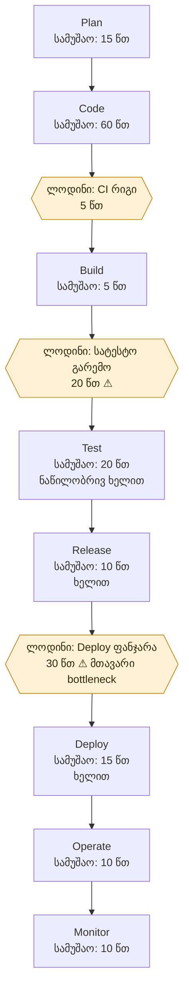

# Lab 01 — DevOps ციკლი და Value Stream Map

## სცენარი

არსებულ Spring Boot აპლიკაციაში უნდა დაემატოს სტუდენტების სახელით ძებნა: `GET /students?name=...`. დავალება სრულდება **ინდივიდუალურად** — ერთი სტუდენტი ეტაპობრივად ირგებს ანალიტიკოსის, დეველოპერის, ტესტერისა და DevOps/ოპერაციების როლებს.

## 1. DevOps-ის ეტაპები და პასუხისმგებლობები

| ეტაპი | როლი (ყველა როლს ერთი სტუდენტი ასრულებს) | მოქმედება | შესაძლო ინსტრუმენტი | აქტიური სამუშაო | ლოდინი | ხელით შესასრულებელი ნაბიჯი |
|---|---|---|---|---:|---:|---|
| Plan | ანალიტიკოსი | მოთხოვნისა და მიღების კრიტერიუმების ჩამოწერა | GitHub Issues | 15 წთ | 0 წთ | დიახ |
| Code | Backend developer | REST endpoint-ისა და ძებნის ლოგიკის დაწერა | IntelliJ IDEA, Git | 60 წთ | 0 წთ | დიახ |
| Build | Build engineer | აპლიკაციის აწყობა | Maven, GitHub Actions | 5 წთ | 5 წთ (CI რიგი) | არა, ავტომატიზაციის შემთხვევაში |
| Test | QA engineer | Unit/API ტესტების შემოწმება | JUnit, Postman | 20 წთ | 20 წთ (ტესტის გარემო) | ნაწილობრივ |
| Release | Release manager | ვერსიის მონიშვნა და ცვლილებების აღწერა | Git tags, GitHub Releases | 10 წთ | 0 წთ | დიახ |
| Deploy | DevOps engineer | ახალი ვერსიის სატესტო გარემოში გაშვება | Docker Compose | 15 წთ | 30 წთ (deployment window) | დიახ |
| Operate | Operator | კონტეინერისა და API-ის მუშაობის შემოწმება | Docker CLI, curl | 10 წთ | 0 წთ | ნაწილობრივ |
| Monitor | Monitoring engineer | ლოგებისა და შეცდომების კონტროლი | Docker logs, Grafana (სურვილისამებრ) | 10 წთ | 0 წთ | ნაწილობრივ |

> დროები **პირობითი, სასწავლო შეფასებებია** და არა გაზომილი შედეგები. GitHub Actions, Docker Compose და Grafana სცენარის შესაძლო ინსტრუმენტებია; ამ ლაბორატორიაში მათი რეალური გამართვა აუცილებელი არ არის.

## 2. Value Stream Map (VSM)

**შეჯამება:**

- აქტიური სამუშაო: **145 წთ** (2 სთ 25 წთ)
- ლოდინი: **55 წთ** (5 + 20 + 30)
- მთლიანი ხანგრძლივობა: **200 წთ** (3 სთ 20 წთ)
- ლოდინის წილი: **27.5%**
- ყველაზე დიდი „ვიწრო ადგილი“: Deploy-მდე 30-წუთიანი ლოდინი; მეორე: სატესტო გარემოს 20-წუთიანი ლოდინი.

## 3. ანალიზი (4 წინადადება)

ამ სიმულაციაში ყველაზე მეტი დრო Deploy ეტაპამდე იკარგება, რადგან განთავსების ფანჯრის დალოდება 30 წუთს მოითხოვს. მეორე მნიშვნელოვანი შეფერხებაა სატესტო გარემოს მომზადების 20-წუთიანი ლოდინი. ხელით შესასრულებელი release-ისა და deploy-ის ნაბიჯები პროცესს ანელებს და ადამიანური შეცდომის რისკსაც ზრდის. პროცესს გავაუმჯობესებდი ავტომატური CI/CD pipeline-ით, წინასწარ მომზადებული სატესტო გარემოთი და ავტომატური ტესტებით, რათა ლოდინი და ხელით ჩარევა შემცირდეს.
